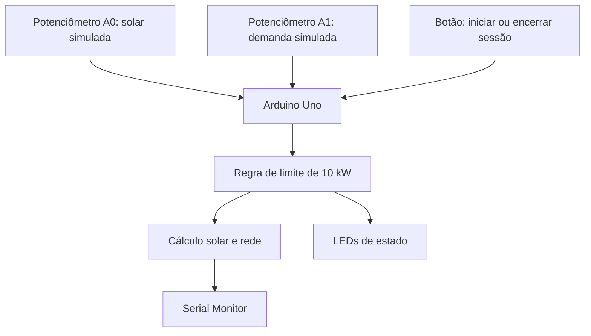
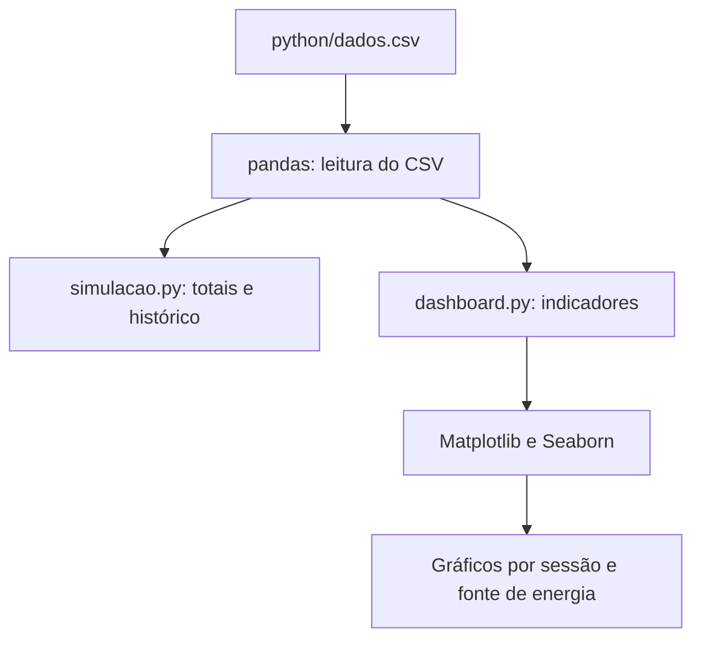

# Arquitetura do Gurgel — Sprint 4

## 1. Componentes identificados

### Protótipo embarcado simulado

O arquivo `tinkercad/prototipo.ino` descreve um circuito baseado em Arduino Uno com:

- potenciômetro em A0: representa potência solar simulada;
- potenciômetro em A1: representa demanda simulada;
- botão no pino digital 7: alterna o início e o fim da sessão;
- LEDs nos pinos 8, 9, 10 e 11: indicam o estado da lógica;
- Serial Monitor: exibe valores e mensagens de estado.

O programa converte as leituras analógicas para faixas de potência definidas no código. A entrada solar é escalada para 0–12 kW e a demanda para 0–15 kW.

### Scripts Python

- `python/gerenciamento.py`: recebe demanda e potência solar digitadas no terminal e aplica a regra de limite.
- `python/dados.csv`: contém oito registros ilustrativos.
- `python/simulacao.py`: calcula totais e exibe um resumo do CSV.
- `python/dashboard.py`: calcula indicadores e apresenta gráficos usando pandas, NumPy, Matplotlib e Seaborn.

Os scripts Python analisam o CSV separadamente. Não há, nos arquivos descritos, evidência de comunicação automática entre o Arduino e os scripts Python.

## 2. Regra de gerenciamento

O limite de potência configurado é 10 kW.

1. A demanda é comparada com o limite.
2. A potência liberada é a demanda quando ela não excede o limite; caso contrário, fica limitada a 10 kW.
3. A potência solar utilizada é o menor valor entre potência solar simulada e potência liberada.
4. A potência atribuída à rede é a diferença entre potência liberada e potência solar utilizada.
5. O estado é indicado por mensagens no Serial Monitor e por um LED.

A lógica do protótipo representa um cenário acadêmico. Ela não deve ser conectada diretamente a um carregador real sem projeto elétrico, dispositivos apropriados, proteções e validação por profissionais habilitados.

## 3. Diagrama de blocos

## 4. Fluxo de análise dos dados

## 5. Interface e GurAI

A documentação geral do projeto menciona interface e GurAI como partes da proposta. Para a versão final, a equipe deve incluir capturas de tela e explicar quais interações funcionam no protótipo atual. Não há evidência, nos scripts listados acima, de que o GurAI esteja conectado em tempo real ao Arduino ou de que execute pagamentos.

## 6. Relação com GoodWe

A arquitetura conversa conceitualmente com gerenciamento de energia, integração de geração renovável e consumo. Entretanto, o circuito mostrado usa Arduino Uno e potenciômetros como entradas simuladas; não demonstra ligação direta a equipamento GoodWe. A integração real deve ser tratada como trabalho futuro, salvo evidência adicional da equipe.
