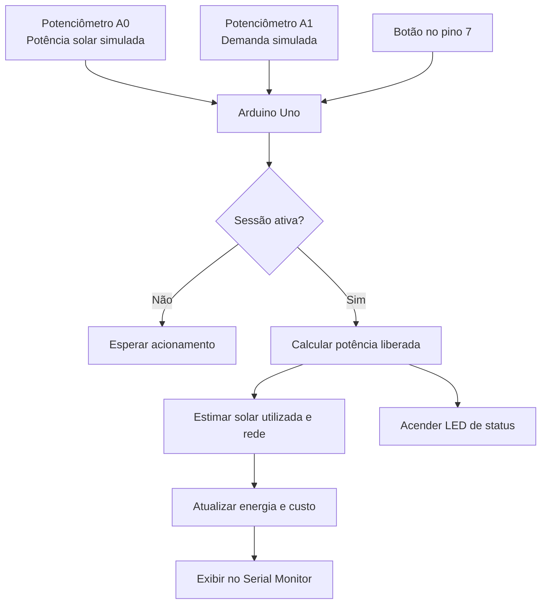
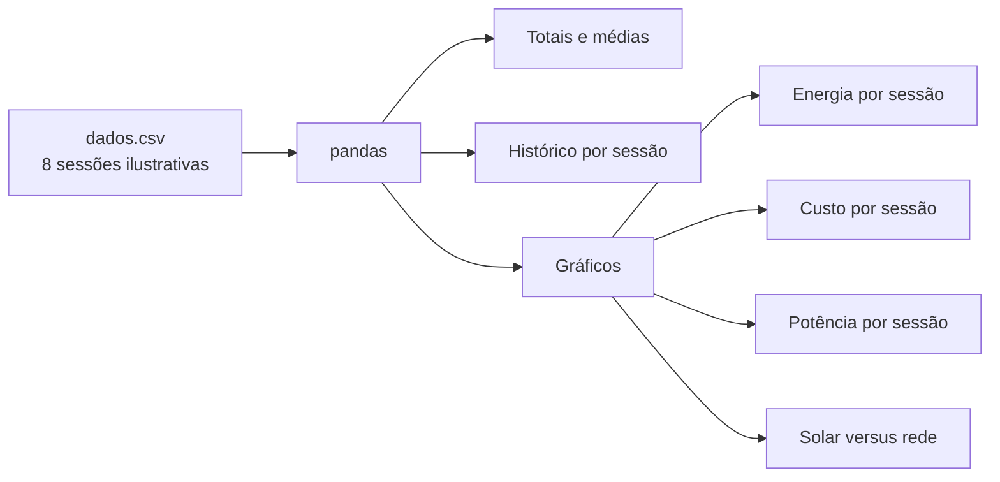
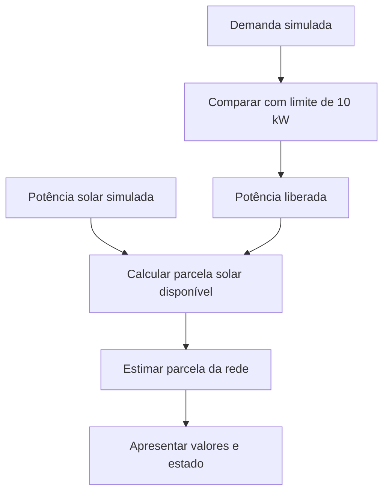

# Diagramas funcionais — Gurgel Sprint 4

Os diagramas abaixo representam os fluxos documentados no repositório. Eles não indicam uma conexão automática entre os scripts Python e o circuito Arduino.

## 1. Circuito de monitoramento e controle



## 2. Análise do CSV



## 3. Conceito de gerenciamento energético



## 4. Imagem do circuito

A equipe enviou uma captura do circuito Arduino Uno com dois potenciômetros, botão e quatro LEDs. Salvem a imagem no repositório como `Sprint4/imagens/circuito-arduino.png` e adicionem abaixo uma referência Markdown:

```markdown

```

Não é possível inserir automaticamente a imagem que foi enviada no chat diretamente no repositório sem que o arquivo de imagem esteja disponível para upload. Salvem a imagem original e façam o upload para essa pasta.
